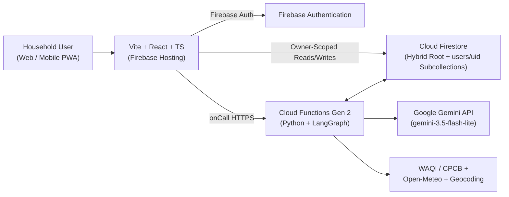

# BreathWiseAI

**Know Your Air. Protect Your Family. Make Every Action Count.**

[](https://breathwise-ai.web.app)
[](./client)
[](./functions)
[](./docs/DATA_MODEL.md)
[](./LICENSE)

**BreathWiseAI** is an open-source, AI-powered personal clean-air assistant built for Indian households. Instead of showing raw AQI numbers in isolation, it combines real-time **CPCB NAQI** air-quality data, hourly forecasts, weather, and your family profile through a **deterministic risk engine + LangGraph + Google Gemini** workflow to generate practical daily routines, indoor air guidance, lower-emission lifestyle alternatives, and transparent environmental impact tracking.

> **Live Demo**: [https://breathwise-ai.web.app](https://breathwise-ai.web.app)

---

## Key Features

- **Real-Time Air Quality Dashboard** — Live **India CPCB NAQI (0–500)**, PM2.5, PM10, temperature, humidity, wind, and hourly forecasts from WAQI/CPCB + Open-Meteo, with explicit freshness status (`fresh` / `stale` / `unavailable`) and tap-to-learn plain-English metric explainers.
- **Multi-City Picker, Saved Cities & Custom Labels** — Search any city, detect your current area via GPS, pin favorite cities, label them (`My City`, `Home Town`, `Office`, `Parents`, or any custom name), and see **`Plan ready`** indicators for cities that already have today's plan.
- **Family & Home Profile (with AI Parser)** — Capture household members, age groups, school/work schedules, commute habits, indoor equipment (HEPA purifier, kitchen exhaust, N95 masks), and optional private health sensitivities manually or via plain-language AI extraction.
- **AI Personalized Daily Clean-Air Planner** — Generates morning, afternoon, and evening routines grounded in live AQI, deterministic safety constraints, and verified public-health RAG citations. Every recommendation states **what to do**, **why**, an **alternative**, and **supporting data**, with persisted completion tracking.
- **Indoor Air Quality Advisor** — Questionnaire-based home assessment covering cooking fuel, exhaust ventilation, incense/dhoop, dusting habits, and window sealing — clearly labeled as **Estimated (questionnaire-based)** rather than sensor-measured PM2.5.
- **Conversational Clean-Air Copilot** — Multi-turn AI chat powered by Gemini native tool calling across 7 deterministic domain tools (live pollutants, hourly safe-window lookup, family schedule risks, impact history, indoor mitigation, and verified RAG search).
- **Sustainability & Impact Tracker** — Log lower-emission commutes and exposure-protection actions while keeping **estimated kg CO₂e avoided** (with transparent formulas & emission factors) strictly separate from **personal exposure reduction**.
- **Multilingual Indian Languages & PWA** — Real-time cached translation for Indian languages, light/dark themes, and installable Progressive Web App support.
- **Built-in Per-User Account Quotas** — Server-enforced per-user lifetime quotas and burst rate limits (visible in **Settings → Usage**) so self-hosters can keep Gemini API costs strictly bounded.

---

## Architecture



### Hybrid Firestore Data Model

BreathWiseAI uses a **Hybrid Root + `users/{userId}` Subcollections** layout (see [docs/DATA_MODEL.md](./docs/DATA_MODEL.md)):

- **Shared Global Root Collections** (non-PII, Admin SDK write-only):
  - `air_quality/{locationId}` + `/forecasts/{hourKey}` — Shared 30-min AQI / 3-hr forecast cache.
  - `knowledge_base/{docId}` — Verified public-health & indoor-air RAG chunks.
  - `translation_cache/{key}` — Server-side multilingual translation cache.
- **Owner-Scoped Per-User Subtree (`users/{userId}/...`)** (zero billable Security Rule `get()` calls):
  - `users/{uid}/families/{familyId}` + `/members/{memberId}`
  - `users/{uid}/daily_plans/{YYYY-MM-DD}_{locationId}` (O(1) deterministic point reads)
  - `users/{uid}/chat_sessions/{sessionId}` + `/messages/{messageId}`
  - `users/{uid}/impact_logs/{logId}`
  - `users/{uid}/saved_cities/{locationId}` (pinned cities & custom labels like `My City`, `Home Town`)
  - `users/{uid}/private/usage` (Admin-SDK-only quota & burst counters)

### AI Safety & Grounding Invariants

1. **Deterministic Risk First** — AQI severity tiers, sensitive-group escalation (children, elderly, respiratory/cardiac sensitivities), and hard safety constraints are computed in deterministic Python code before Gemini generates prose.
2. **Validation Gate + Deterministic Fallback** — Every LLM output is validated against Pydantic contracts and deterministic constraints; if Gemini or an external API is unavailable, a safe deterministic fallback is returned.
3. **Zero Fabricated Data** — Missing readings render explicit unavailable states; safe time windows are never claimed without supporting hourly forecast data.
4. **Non-Medical Boundary** — Never diagnoses conditions or prescribes medications; escalates to qualified medical care on `Severe` AQI (>400) or acute symptom queries.

---

## Tech Stack

| Layer | Technologies |
|---|---|
| **Frontend (`client/`)** | React 19, TypeScript 5.8, Vite 6, React Router 7, Tailwind CSS 4, Lucide Icons, Recharts, Vitest, `pnpm` |
| **Backend (`functions/`)** | Firebase Cloud Functions Gen 2 (`on_call`), Python 3.12–3.14, LangGraph, Pydantic v2, Google GenAI SDK (`google-genai`), Pytest, Ruff |
| **AI & Grounding** | Google Gemini (`gemini-3.5-flash-lite` with `ThinkingLevel.MINIMAL`), native function calling, verified RAG knowledge base |
| **Environmental APIs** | WAQI / CPCB India stations (primary AQI), Open-Meteo Air Quality & Weather (forecasts & fallback), Open-Meteo Geocoding |
| **Infrastructure** | Firebase Authentication, Cloud Firestore (rules + indexes), Firebase Hosting, Google Cloud Secret Manager |

---

## Getting Started (Local Development)

### Prerequisites

- **Node.js** 20+ and **pnpm** (`corepack enable` or `npm i -g pnpm`)
- **Python** 3.12+ (3.14 configured in `firebase.json`)
- **Firebase CLI** (`npm i -g firebase-tools`)
- A **Google Gemini API Key** ([Google AI Studio](https://aistudio.google.com/apikey))
- *(Optional)* A **WAQI API Token** ([aqicn.org](https://aqicn.org/data-platform/token/)) — if omitted, the backend automatically falls back to Open-Meteo Air Quality.

### 1. Clone the Repository

```bash
git clone https://github.com/amide-init/BreathWiseAI.git
cd BreathWiseAI
```

### 2. Configure Frontend (`client/`)

```bash
cd client
cp .env.example .env
pnpm install
```

Edit `client/.env` with your Firebase Web App credentials (public client config only — **never** put `GEMINI_API_KEY` or `WAQI_API_TOKEN` in `client/.env`):

```env
VITE_FIREBASE_API_KEY=your-firebase-api-key
VITE_FIREBASE_AUTH_DOMAIN=your-project-id.firebaseapp.com
VITE_FIREBASE_PROJECT_ID=your-project-id
VITE_FIREBASE_STORAGE_BUCKET=your-project-id.firebasestorage.app
VITE_FIREBASE_MESSAGING_SENDER_ID=your-messaging-sender-id
VITE_FIREBASE_APP_ID=your-firebase-web-app-id
VITE_FUNCTIONS_REGION=asia-south1
VITE_USE_EMULATORS=true
```

### 3. Configure Backend (`functions/`)

```bash
cd ../functions
python3 -m venv venv
source venv/bin/activate   # Windows: venv\Scripts\activate
pip install -r requirements.txt -r requirements-dev.txt
```

Create `functions/.env.local` (git-ignored) for local emulator runs:

```env
GEMINI_API_KEY=your-gemini-api-key
WAQI_API_TOKEN=your-waqi-token
GEMINI_MODEL=gemini-3.5-flash-lite
BREATHEWISE_REGION=asia-south1
```

### 4. Start Firebase Emulators & Vite Dev Server

In terminal 1 (project root):

```bash
firebase emulators:start
```

In terminal 2 (`client/`):

```bash
cd client
pnpm dev
```

Open [http://localhost:5173](http://localhost:5173) (Emulator UI runs on [http://localhost:4000](http://localhost:4000)).

---

## Deploying to Your Own Firebase Project

1. **Create & select your Firebase project** (Blaze plan is required for Cloud Functions Gen 2):
   ```bash
   firebase login
   firebase use --add   # select your Firebase project ID
   ```
2. **Enable services in Firebase Console**:
   - **Authentication** → Enable **Email/Password** and/or **Google** sign-in providers.
   - **Cloud Firestore** → Create `(default)` database (recommended region: `asia-south1`).
   - **Hosting** → Update `"site"` in `firebase.json` to match your project's Hosting site ID (or remove `"site"` to use your default site).
3. **Set backend secrets in Google Cloud Secret Manager**:
   ```bash
   firebase functions:secrets:set GEMINI_API_KEY
   firebase functions:secrets:set WAQI_API_TOKEN
   ```
4. **Update `client/.env`** with your production Firebase Web App config and set `VITE_USE_EMULATORS=false`.
5. **Build the frontend & deploy everything**:
   ```bash
   pnpm --dir client build
   firebase deploy --only firestore,functions,hosting
   ```
6. *(Optional)* **Seed `knowledge_base/` into Firestore** (the backend also falls back to bundled verified docs automatically):
   ```bash
   cd functions
   venv/bin/python scripts/seed_knowledge_base.py
   ```

---

## Cloud Functions API (`functions/main.py`)

All 12 endpoints are Firebase Cloud Functions Gen 2 `https_fn.on_call` callables deployed to `asia-south1`:

| Function | Auth Required | Description |
|---|---|---|
| `health_check` | No | Service health & operational verification |
| `search_locations` | No | Cache-backed city geocoding & normalization |
| `get_air_quality` | No | Live/cached CPCB NAQI, PM2.5, PM10, weather, hourly forecasts & quick verdicts |
| `translate_texts` | No | Bounded batch UI translation with Firestore cache |
| `generate_daily_plan` | Yes | LangGraph daily clean-air routine planner persisted to `users/{uid}/daily_plans/{date}_{loc}` |
| `assess_indoor_air` | Yes | Questionnaire-based indoor air quality estimate & mitigation advice |
| `send_chat_message` | Yes | Multi-turn conversational AI copilot with 7 native Gemini domain tools |
| `parse_household_profile` | Yes | Natural-language extraction of family members, habits, and indoor equipment |
| `log_impact_action` | Yes | Server-side CO₂e avoided calculation & exposure-action logging |
| `get_impact_summary` | Yes | Separated emissions-avoided vs. exposure-reduction summary |
| `delete_impact_action` | Yes | Delete a user-owned impact log entry |
| `get_user_usage` | Yes | Returns per-user quota usage & burst limits for **Settings → Usage** |

---

## Running Tests & Quality Checks

### Backend (`functions/`)

```bash
cd functions
venv/bin/ruff check app tests
venv/bin/pytest -v
```

### Frontend (`client/`)

```bash
pnpm --dir client typecheck
pnpm --dir client lint
pnpm --dir client test
pnpm --dir client build
```

---

## Repository Structure

```text
BreathWiseAI/
├── client/                     # Vite + React 19 + TypeScript + Tailwind 4 PWA
│   ├── src/
│   │   ├── components/         # Shared UI, Dashboard, Planner, Assistant & Impact components
│   │   ├── config/             # Cities, AQI visual tokens, metric explainers, routes
│   │   ├── context/            # Auth, Location (with Saved Cities & Labels), Theme, i18n
│   │   ├── hooks/              # Air quality, Daily Plan, Family Profile, Usage hooks
│   │   ├── pages/              # Dashboard, Planner, Assistant, Impact, Profile, Settings, Onboarding
│   │   └── services/           # Firestore subcollection & Firebase Callable clients
│   └── .env.example            # Frontend public Firebase config template
├── functions/                  # Firebase Cloud Functions Gen 2 (Python)
│   ├── main.py                 # Thin on_call bootstrapper (12 callables)
│   ├── app/
│   │   ├── graph/              # LangGraph workflow nodes & state definitions
│   │   ├── providers/          # Gemini structured/tool-calling, WAQI, Open-Meteo clients
│   │   ├── rag/                # Verified knowledge chunks & deterministic retriever
│   │   ├── repositories/       # Firestore subcollection & cache repositories
│   │   ├── routes/             # Callable request handlers
│   │   ├── schemas/            # Pydantic v2 request/response contracts
│   │   └── services/           # Deterministic risk engine, planner, chat, indoor, impact, quota
│   ├── scripts/                # seed_knowledge_base.py
│   └── tests/                  # Pytest unit, workflow, safety red-team & subcollection tests
├── docs/                       # Architecture, Data Model, AI Workflow, API, UI/UX & Impact specs
├── firestore.rules             # Owner-scoped Firestore Security Rules
├── firestore.indexes.json      # Firestore composite indexes
├── firebase.json               # Hosting, Functions, Firestore & Emulator configuration
└── PRD.md                      # Product Requirements Document
```

---

## Documentation

| Document | Contents |
|---|---|
| [PRD.md](./PRD.md) | Product Requirements Document, user journeys & acceptance criteria |
| [docs/ARCHITECTURE.md](./docs/ARCHITECTURE.md) | System architecture, caching strategy & Firebase services |
| [docs/DATA_MODEL.md](./docs/DATA_MODEL.md) | Hybrid Firestore schemas, indexes & security access matrix |
| [docs/AI_WORKFLOW.md](./docs/AI_WORKFLOW.md) | LangGraph orchestration, Pydantic schemas, deterministic risk rules & RAG |
| [docs/API_SPEC.md](./docs/API_SPEC.md) | Cloud Functions API & external environmental provider contracts |
| [docs/UI_UX_SPEC.md](./docs/UI_UX_SPEC.md) | Screen blueprints, CPCB NAQI severity tokens & PWA states |
| [docs/IMPACT_AND_KNOWLEDGE.md](./docs/IMPACT_AND_KNOWLEDGE.md) | CO₂ emission factor formulas & verified RAG knowledge base |

---

## Disclaimer

BreathWiseAI provides **general environmental and air-quality guidance** for informational purposes only. It is **not a medical device** and does not diagnose, treat, cure, or prevent any disease. Always consult a qualified healthcare professional for respiratory or cardiovascular symptoms and follow official local public-health advisories during severe pollution episodes.

---

## Contributing

Contributions, bug reports, and feature ideas are welcome!

1. Fork the repository and create a feature branch (`git checkout -b feat/your-feature`).
2. Follow the repository conventions:
   - Use **`pnpm`** in `client/` (never `npm` or `yarn`).
   - Keep all AI safety, deterministic risk, and data-freshness invariants intact.
   - Never expose API secrets in `client/` or `VITE_*` variables.
3. Run both test suites (`ruff` + `pytest` in `functions/`, and `typecheck` + `lint` + `test` + `build` in `client/`) before opening a Pull Request.

---

## License

This project is open source and licensed under the [MIT License](./LICENSE).
