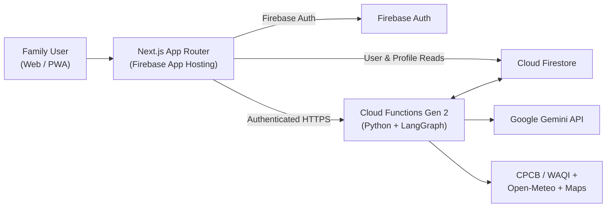

# BreatheWise AI

**Know Your Air. Protect Your Family. Make Every Action Count.**

BreatheWise AI is a GenAI-powered personal clean-air assistant built as a 10-day hackathon MVP. Rather than just displaying AQI numbers, it combines real-time air-quality data, weather, and family profiles through a deterministic-plus-LLM LangGraph workflow to generate actionable daily routines, indoor air quality guidance, lower-emission alternatives, and transparent environmental impact estimates.

---

## System Overview



---

## Core MVP Modules

1. **Air Quality Intelligence Dashboard** — Location-based CPCB NAQI, PM2.5, PM10, weather, forecasts, data freshness, and plain-language guidance.
2. **Family Profile & Personalization** — Household members, age groups, work/school schedules, exercise/commute habits, indoor equipment, and optional private health sensitivities.
3. **AI Personalized Daily Planner** — Morning, afternoon, and evening clean-air routines where every action explains *what*, *why*, *alternative*, and *supporting data*.
4. **Indoor Air Quality Advisor** — Home pollution questionnaire and tailored filtration, cooking, dust, and ventilation guidance (distinguishing measured vs. estimated indoor conditions).
5. **Sustainability & Impact Tracker** — Lower-emission commuting/energy alternatives, daily action tracking, transparent CO2 avoided estimates, and separate exposure-reduction indicators.
6. **Conversational AI Assistant** — Natural-language environmental guidance grounded in live environmental data, family context, and a verified RAG knowledge base.

---

## Documentation Index

| Document | Description |
|---|---|
| [PRD.md](./PRD.md) | Complete Product Requirements Document (v1.0) |
| [GEMINI.md](./GEMINI.md) | Always-on Antigravity workspace handbook & guardrails |
| [docs/ARCHITECTURE.md](./docs/ARCHITECTURE.md) | System architecture, monorepo layout, caching & Firebase services |
| [docs/DATA_MODEL.md](./docs/DATA_MODEL.md) | Cloud Firestore collections, schemas, indexes & access matrix |
| [docs/AI_WORKFLOW.md](./docs/AI_WORKFLOW.md) | 5-node LangGraph architecture, Pydantic contracts, deterministic risk rules & RAG |
| [docs/API_SPEC.md](./docs/API_SPEC.md) | Backend Cloud Functions API & external AQI/weather/maps contracts |
| [docs/UI_UX_SPEC.md](./docs/UI_UX_SPEC.md) | 5 MVP screens, AQI severity visual tokens, PWA & state patterns |
| [docs/IMPACT_AND_KNOWLEDGE.md](./docs/IMPACT_AND_KNOWLEDGE.md) | CO2 emission factor formulas & verified `knowledge_base/` seed blueprint |
| [docs/ROADMAP_AND_TASKS.md](./docs/ROADMAP_AND_TASKS.md) | Day 1–10 build plan, FR traceability & 10-step demo checklist |

---

## Antigravity Customizations

This repository ships pre-configured Antigravity rules and skills under `.agents/`:

- **Rules (`.agents/rules/`)**:
  - [ai-safety-and-grounding.md](./.agents/rules/ai-safety-and-grounding.md) — Always-on AI safety, grounding, and data honesty constraints.
  - [client-nextjs.md](./.agents/rules/client-nextjs.md) — Scoped to `client/**/*` (Next.js App Router, Shadcn UI, Recharts, PWA).
  - [backend-python-langgraph.md](./.agents/rules/backend-python-langgraph.md) — Scoped to `functions/**/*` (Cloud Functions Gen 2 Python, LangGraph, Gemini, Pydantic).
  - [firestore-and-security.md](./.agents/rules/firestore-and-security.md) — Loaded on demand for Firestore data modeling, rules, and auth security.
- **Skills (`.agents/skills/`)**:
  - [implement-feature](./.agents/skills/implement-feature/SKILL.md) — End-to-end vertical-slice feature workflow.
  - [build-langgraph-node](./.agents/skills/build-langgraph-node/SKILL.md) — Implementing and testing LangGraph nodes & Pydantic schemas.
  - [verify-ai-safety](./.agents/skills/verify-ai-safety/SKILL.md) — Red-team & grounding safety validation runbook.
  - [prepare-hackathon-demo](./.agents/skills/prepare-hackathon-demo/SKILL.md) — 10-step hackathon demo dry-run verification.

---

## Planned Repository Structure & Quick Start

> **Status**: Documentation & specification phase complete. Application code will be initialized starting on **Day 1** per [docs/ROADMAP_AND_TASKS.md](./docs/ROADMAP_AND_TASKS.md).

```text
BreathWiseAI/
├── client/                    # Next.js App Router + TypeScript + Tailwind + Shadcn UI + Recharts
├── functions/                 # Firebase Cloud Functions Gen 2 (Python 3.12 + LangGraph + Gemini)
├── docs/                      # Architecture, Data Model, AI Workflow, API, UI/UX, Impact, Roadmap
├── .agents/                   # Antigravity workspace rules & skills
├── firebase.json              # Firebase emulators, functions, firestore configuration
├── apphosting.yaml            # Firebase App Hosting configuration
├── firestore.rules            # Firestore security rules
└── firestore.indexes.json     # Firestore composite indexes
```

### Planned Local Development Commands (Day 1+)

- **Client (`client/`)**: `npm install && npm run dev`
- **Backend (`functions/`)**: Python virtualenv + `pip install -r requirements.txt` + `firebase emulators:start`
- **Tests**: Client (`npm run lint && npm run typecheck && npm test`), Backend (`pytest`)
