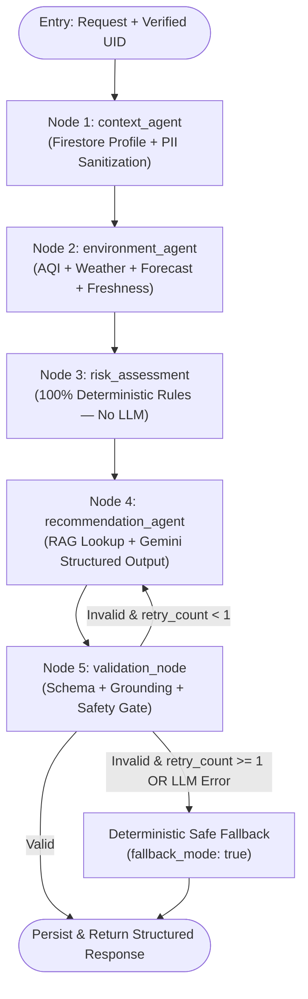

# AI Workflow & LangGraph Specification — BreatheWise AI

> Derived from [PRD.md](../PRD.md) §7. Defines the 5-node LangGraph state graph, shared state schema, deterministic CPCB NAQI risk engine, RAG grounding pipeline, Gemini structured outputs, validation gate, and safe fallback behavior.

---

## 1. Five-Node LangGraph Topology

The same core five-node graph powers **Daily Plan Generation**, **Indoor Air Quality Advisor**, and the **Conversational AI Assistant**, parameterized by `workflow_mode`.



**Execution Bounds**:
- Max validation retries: `1` (at most 2 Gemini calls total).
- Per-Gemini-call timeout: `20s`.
- Total graph deadline: `30s`.

---

## 2. Shared `BreatheWiseState` Schema

```python
# Conceptual state contract (implemented in functions/app/graph/state.py)
# Mode: "daily_plan" | "indoor_advisor" | "chat"
```

| State Field | Set By | Type / Summary |
|---|---|---|
| `workflow_mode` | Caller | `"daily_plan"` \| `"indoor_advisor"` \| `"chat"` |
| `user_id` | Caller (verified JWT) | `str` |
| `location_id` | Caller / Node 1 | `str` |
| `user_query` | Caller (`chat` mode) | `str \| None` |
| `chat_history` | Node 1 (`chat` mode) | Last ≤ 6 sanitized turns (`role`, `content`) |
| `indoor_answers` | Caller (`indoor_advisor`) | Structured questionnaire map |
| `sanitized_context` | Node 1 | Age groups, roles, schedules, commute/exercise habits, indoor equipment, boolean sensitivity flags (NO raw PII/names/emails) |
| `environment_data` | Node 2 | Normalized AQI, PM2.5, PM10, weather, hourly forecasts, `observed_at`, `source`, `freshness_status` |
| `risk_assessment` | Node 3 | Deterministic severity tier, sensitive-group escalation, `RiskConstraints` flags, `medical_escalation_required` |
| `retrieved_docs` | Node 4 | Top 3–5 verified `knowledge_base` chunks matching topic & risk tier |
| `draft_output` | Node 4 | Pydantic-parsed Gemini output (`DailyPlanOutput` \| `IndoorAdviceOutput` \| `ChatReplyOutput`) |
| `validation_errors` | Node 5 | List of violation strings passed back on retry |
| `retry_count` | Node 5 | `int` (`0` or `1`) |
| `fallback_mode` | Node 4 / 5 | `bool` (`True` if deterministic fallback used) |
| `final_output` | Node 5 | Validated final Pydantic payload |

---

## 3. Node-by-Node Specification

### Node 1: `context_agent`
- **Responsibilities**:
  - Load `users/{user_id}`, active `families/{family_id}`, and `families/{family_id}/members/*`.
  - If `workflow_mode == "chat"`, load up to 6 most recent messages from `chat_sessions/{session_id}/messages`.
  - Project into `sanitized_context`: map member details to anonymized descriptors (e.g., `"working_adult (18-45)"`, `"school_child (6-12)"`), schedules, commute mode/km, exercise preferences, indoor equipment (`has_hepa_purifier`, `has_kitchen_exhaust`, etc.), and boolean sensitivity flags (`has_respiratory_sensitivity`, `has_elderly`, `has_children`).
- **Missing Profile Behavior**: If the user has not completed Family Profile yet, populate sensible general defaults (`profile_complete: False`) so the assistant still works while noting personalization can be improved.

### Node 2: `environment_agent`
- **Responsibilities**:
  - Call the cache-first Environmental Data Service ([API_SPEC.md](./API_SPEC.md)) for `location_id`.
  - Normalize AQI (CPCB NAQI), PM2.5 (`µg/m³`), PM10 (`µg/m³`), weather (temp, humidity, wind), and available hourly forecasts.
  - Classify `freshness_status`:
    - `fresh`: observation age ≤ 30 min (or freshly retrieved from live provider).
    - `stale`: observation age > 30 min (live providers unreachable, serving cached data).
    - `unavailable`: neither live nor cached reading exists (`aqi = None`).
  - **Strict rule**: Never fill missing pollutants or forecasts with defaults or zeros.

### Node 3: `risk_assessment` (100% Deterministic — Zero LLM Calls)

Computes risk tier and hard recommendation constraints solely from CPCB NAQI breakpoints, pollutant values, `freshness_status`, user sensitivity flags, and acute-symptom keyword detection (in `chat` mode).

#### CPCB NAQI Deterministic Breakpoints & Base Constraints

| CPCB NAQI Range | Category | `allow_strenuous_outdoor` | `allow_child_outdoor_play` | `recommend_mask_outdoors` | `recommend_windows_closed` | `recommend_hepa_if_owned` |
|---|---|---|---|---|---|---|
| `0 – 50` | `Good` | `True` | `True` | `False` | `False` (ventilate OK) | `False` |
| `51 – 100` | `Satisfactory` | `True` | `True` | `False` | `False` | `False` |
| `101 – 200` | `Moderate` | `True` (caution if sensitive) | `True` (limit prolonged if sensitive) | `False` (optional if sensitive) | `False` | `True` (if sensitive) |
| `201 – 300` | `Poor` | `False` | `False` (prefer indoor) | `True` | `True` | `True` |
| `301 – 400` | `Very Poor` | `False` | `False` | `True` | `True` | `True` |
| `401 – 500+` | `Severe` | `False` | `False` | `True` (N95/equivalent; minimize all outdoor exposure) | `True` | `True` |
| `None` | `Unavailable` | `False` (precautionary — unknown air quality) | `False` (advise checking local official AQI) | `False` (state data unavailable) | `False` | `True` (general precaution) |

#### Deterministic Modifiers
1. **Sensitive Group Escalation**: If household has `child_toddler` (`0_5`), `child_school` (`6_12`), `elderly` (`60_plus`), or `has_respiratory_sensitivity == True`:
   - At `Moderate` (`101–200`): set `allow_strenuous_outdoor = False` for sensitive members and advise moderating prolonged outdoor exertion.
2. **Stale Data Flag**: If `freshness_status == "stale"`, set `require_freshness_caveat = True` and `allow_specific_safe_window_claims = False`.
3. **Forecast Availability Gate**: Set `allow_specific_safe_window_claims = True` ONLY if hourly forecast data exists AND has at least one future hour with forecast NAQI ≤ `100` (otherwise `False`).
4. **Medical Escalation Gate**: Set `medical_escalation_required = True` if `category == "Severe"` OR `user_query` matches acute symptom keywords (`wheezing`, `asthma attack`, `chest pain`, `shortness of breath`, `trouble breathing`, `dizzy`, `inhaler dosage`, `diagnose`).

### Node 4: `recommendation_agent` (RAG + Google Gemini)
- **RAG Retrieval**:
  - Query `knowledge_base/` by matching `applicableRiskTiers` (current category + `"All"`) and relevant topics based on `workflow_mode` (`aqi_health`, `children_elderly`, `indoor_air`, `cooking_ventilation`, `hepa_filtration`, `commute_sustainability`, `medical_escalation`).
  - Select top 3–5 concise verified documents and attach their `docId`, `title`, and `sourceAuthority` to prompt context.
- **Prompting & Structured Output**:
  - Pass `sanitized_context`, `environment_data`, deterministic `risk_assessment` constraints (explicitly marked as **IMMUTABLE CONSTRAINTS**), and `retrieved_docs` to Gemini with JSON Schema / Pydantic structured output enforcement.
  - For `daily_plan`: enforce 3 sections (`morning`, `afternoon`, `evening`), each containing 2–3 `RecommendationItem` objects with all 4 mandatory fields (`what_to_do`, `why`, `alternative`, `supporting_data`).
  - For `indoor_advisor`: explicitly include `assessment_basis: "estimated_questionnaire"` (never claim measured indoor PM2.5).
  - For `chat`: concise plain-language answer, grounded citations, 2–3 follow-up chips, and medical disclaimer when appropriate.

### Node 5: `validation_node` (Programmatic Safety Gate)

Runs deterministic Python checks over `draft_output`:
1. **Schema Check**: Validates against target Pydantic model (all required fields non-empty, valid enum values).
2. **Numeric Grounding Check**: Extracts any AQI / PM2.5 / PM10 numeric mentions from output text and verifies they match retrieved `environment_data` (tolerance `±1` for rounding) or retrieved `knowledge_base` thresholds; rejects fabricated measurements when `environment_data` is `unavailable`.
3. **Time-Window Honesty Check**: If `allow_specific_safe_window_claims == False`, rejects phrases claiming a specific safe outdoor window (e.g., *"safe to go out between 2 PM and 4 PM"*).
4. **Constraint Contradiction Check**: If `allow_strenuous_outdoor == False` or `allow_child_outdoor_play == False`, rejects recommendations instructing users to jog/run/play outdoors without prohibition framing.
5. **Medical Boundary Check**: Rejects diagnostic language (*"you have asthma"*, *"take X mg/puffs"*) and verifies medical escalation text is present whenever `medical_escalation_required == True`.
6. **Indoor Estimation Check**: In `indoor_advisor` mode, confirms output does not assert measured indoor PM2.5 values.

**Routing**:
- Pass → return `final_output` (`fallback_mode = False`).
- Fail & `retry_count == 0` → increment `retry_count`, pass `validation_errors` back to `recommendation_agent`.
- Fail & `retry_count >= 1` (or Gemini exception/timeout) → build response from **Deterministic Safe Fallback** templates driven directly by `risk_assessment`, `environment_data`, and `retrieved_docs` with `fallback_mode = True`.
