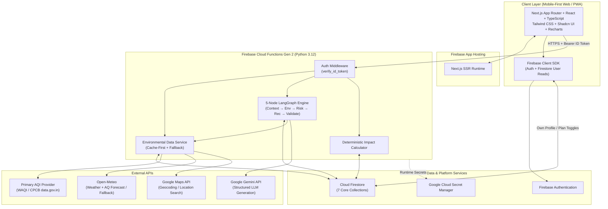
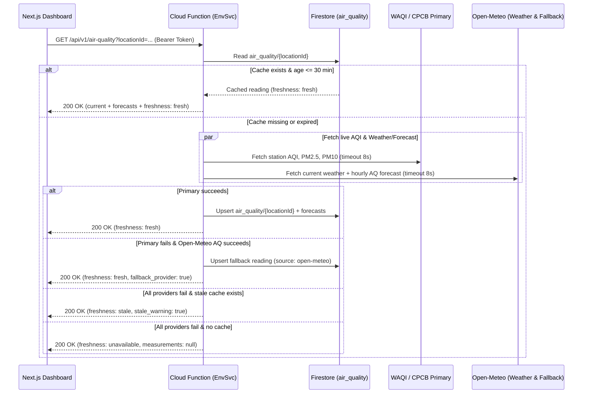

# System Architecture — BreatheWise AI

> Derived from [PRD.md](../PRD.md) §8, §9, and §12. Defines the target architecture, planned monorepo layout, Firebase services, request lifecycles, caching, and non-functional reliability patterns.

---

## 1. High-Level System Architecture



---

## 2. Planned Monorepo Directory Structure

> **Note**: Application directories (`client/`, `functions/`) and root Firebase configs are planned for Day 1 setup. No codebase files exist during the documentation phase.

```text
BreathWiseAI/
├── GEMINI.md                        # Always-on Antigravity handbook
├── README.md                        # Project overview
├── PRD.md                           # Product Requirements Document
├── .agents/                         # Antigravity rules & skills
├── docs/                            # Engineering blueprints (this directory)
├── firebase.json                    # Firebase Emulators, Functions, Firestore config
├── apphosting.yaml                  # Firebase App Hosting config for Next.js SSR
├── firestore.rules                  # Firestore security rules (via firestore-rules-author)
├── firestore.indexes.json           # Composite Firestore indexes
├── client/                          # Next.js App Router (TypeScript)
│   ├── public/                      # PWA manifest, icons, static assets
│   ├── src/
│   │   ├── app/                     # App Router routes (/, /profile, /planner, /assistant, /impact, /login)
│   │   ├── config/                  # Route constants, CPCB AQI visual token maps, app settings
│   │   ├── services/                # Reusable typed API & Firestore client services
│   │   ├── components/              # ui/ (Shadcn), shared/ (AQI badge, freshness/error states), feature components
│   │   ├── lib/                     # Firebase client init, authenticated fetch wrapper, date/AQI utils
│   │   ├── hooks/                   # Reusable auth, location, AQI, planner hooks
│   │   └── types/                   # Shared TypeScript DTOs matching docs/API_SPEC.md
│   └── package.json
└── functions/                       # Firebase Cloud Functions Gen 2 (Python 3.12)
    ├── main.py                      # Thin Cloud Functions Gen 2 HTTP entrypoint wiring
    ├── requirements.txt             # Lean Python runtime dependencies
    ├── app/
    │   ├── config/                  # Typed settings, Secret Manager params, constants (TTLs, breakpoints, EFs)
    │   ├── routes/                  # Thin HTTP route handlers (auth, request validation, response envelopes)
    │   ├── services/                # Reusable use-case orchestrators (air quality, planner, chat, indoor, impact)
    │   ├── providers/               # Protocol-based external API adapters (WAQI/CPCB, Open-Meteo, Maps, Gemini)
    │   ├── repositories/            # Firestore Admin SDK data-access adapters (one per aggregate)
    │   ├── domain/                  # Pure deterministic engines (risk_engine, impact_calculator, aqi_calculator)
    │   ├── rag/                     # Reusable knowledge_base retriever & citation formatter
    │   ├── graph/                   # LangGraph state, workflow, nodes/, prompts/, deterministic fallbacks
    │   ├── schemas/                 # Shared Pydantic v2 request/response/domain contracts
    │   └── utils/                   # Reusable auth guard, typed errors, JSON response builder, httpx client, PII-safe logger, time/freshness utils
    ├── scripts/
    │   └── seed_knowledge_base.py   # Idempotent RAG knowledge_base seeder
    └── tests/                       # Pytest unit, contract, provider, and AI safety tests
```

---

## 3. Firebase Services Allocation

| Service | Role in MVP | Priority | Notes |
|---|---|---|---|
| **Firebase Authentication** | Email/Password + Google Sign-In | P0 | ID tokens verified server-side on every protected Cloud Function |
| **Cloud Firestore** | Primary NoSQL database & AQI cache | P0 | 7 collections per [DATA_MODEL.md](./DATA_MODEL.md) |
| **Cloud Functions Gen 2** | Python REST/HTTPS APIs + LangGraph | P0 | Runs in `asia-south1` (or single chosen region close to users) with Secret Manager |
| **Firebase App Hosting** | Next.js App Router SSR + PWA hosting | P0 | Native Next.js SSR support; auto-manages Cloud Run backend |
| **Firebase Cloud Messaging** | High-pollution push alerts (`FR-12`) | P2 | Deferred unless P0 + P1 are complete |
| **Cloud Storage** | Optional report/document assets | P2 | Optional; not required for MVP core journey |

---

## 4. Core Request Lifecycles

### 4.1 Dashboard Environmental Fetch (`GET /api/v1/air-quality`)



### 4.2 AI Plan & Chat Generation (`POST /api/v1/daily-plan/generate`, `POST /api/v1/chat/message`)

1. Client sends authenticated request with `Authorization: Bearer <Firebase ID Token>`.
2. Cloud Function verifies token → extracts trusted `uid`.
3. Runs the 5-node LangGraph pipeline ([AI_WORKFLOW.md](./AI_WORKFLOW.md)) bounded to ≤ 30 seconds total execution (max 1 validation retry).
4. Persists validated result to `daily_plans/` or `chat_sessions/{sessionId}/messages/` via Admin SDK.
5. Returns structured Pydantic-validated JSON to frontend. If Gemini fails, returns deterministic fallback tagged `fallback_mode: true`.

---

## 5. Non-Functional Architecture Decisions

### Performance & Caching
- **Current AQI TTL**: `30 minutes` per `locationId` in Firestore.
- **Weather & Hourly Forecast TTL**: `3 hours` per `locationId`.
- **Location Geocode Cache**: Cache normalized city/location metadata to reduce Google Maps API calls.
- **Cold-Start Mitigation**: Keep Python dependencies lean and configure `min_instances=1` on the primary AI function during the hackathon demo window.

### Security & Privacy
- All API keys (`GEMINI_API_KEY`, `WAQI_API_TOKEN`, `CPCB_API_KEY`, `GOOGLE_MAPS_SERVER_KEY`) live exclusively in Firebase Functions secrets (Secret Manager).
- Frontend uses only public Firebase web config (`NEXT_PUBLIC_FIREBASE_*`) and optional restricted client Maps key if needed (prefer server-side geocoding to keep keys minimal).
- Structured server logs emit only request IDs, latencies, node outcomes, and `freshness_status` — never user names, emails, or optional health notes.

### Resilience & Graceful Degradation
- External HTTP timeouts: `8s` per upstream provider.
- Gemini generation timeout: `20s` per call.
- Zero unhandled 500s on provider outage: every upstream failure degrades cleanly to `stale` cache, `unavailable` state, or deterministic rule-based guidance.
