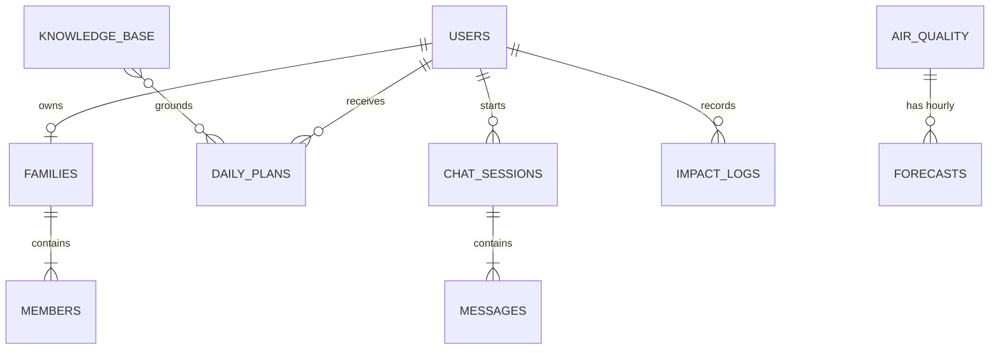

# Cloud Firestore Data Model — BreatheWise AI

> Derived from [PRD.md](../PRD.md) §8.3, §9, and §12. Defines all seven Firestore collections, document schemas, privacy boundaries, composite indexes, and the security access matrix.

> [!IMPORTANT]
> When translating this schema into `firestore.rules`, **always delegate authoring to the `firestore-rules-author` subagent** (never author `firestore.rules` directly in the main agent).

---

## 1. Entity Relationship Overview

---

## 2. Collection Schemas

### 2.1 `users/{userId}`
Stores primary account settings and active location preference. Document ID equals Firebase Auth `uid`.

| Field | Type | Required | Description |
|---|---|---|---|
| `uid` | `string` | Yes | Firebase Auth UID (immutable) |
| `displayName` | `string` | Yes | User display name (max 100 chars) |
| `email` | `string` | Yes | Account email |
| `defaultFamilyId` | `string \| null` | No | Active `families/{familyId}` reference |
| `primaryLocation` | `map` | No | `{ locationId, city, state, country, lat, lng, label }` |
| `aqiScalePreference` | `string` | Yes | Default `"CPCB_NAQI"` (`"CPCB_NAQI"` \| `"US_EPA"`) |
| `onboardingCompleted` | `boolean` | Yes | `false` until location + initial profile saved |
| `createdAt` | `timestamp` | Yes | Server timestamp (immutable) |
| `updatedAt` | `timestamp` | Yes | Server timestamp |

---

### 2.2 `families/{familyId}` & `families/{familyId}/members/{memberId}`

#### Parent Document: `families/{familyId}`
Stores household-level lifestyle, commute, indoor air equipment, and indoor questionnaire baseline.

| Field | Type | Required | Description |
|---|---|---|---|
| `ownerUserId` | `string` | Yes | Firebase Auth UID of owner (immutable) |
| `householdName` | `string` | Yes | e.g., `"Sharma Family"` (max 80 chars) |
| `location` | `map` | Yes | `{ locationId, city, lat, lng, label }` |
| `transportationHabits` | `map` | Yes | `{ primaryMode, dailyCommuteKm, vehicleFuelType, occupancy }` (`primaryMode`: `"personal_car"` \| `"two_wheeler"` \| `"carpool"` \| `"public_transit"` \| `"walk_cycle"` \| `"wfh"`) |
| `exercisePreferences` | `map` | Yes | `{ prefersOutdoor, preferredWindow, activityType }` |
| `indoorEquipment` | `map` | Yes | `{ hasHepaPurifier, purifierRoomsCount, hasKitchenExhaust, hasCrossVentilation, hasN95Masks, indoorSmokingPresent }` |
| `indoorQuestionnaire` | `map \| null` | No | Latest Module 4 questionnaire answers (`cookingFuel`, `incenseOrDhoop`, `dustFrequency`, `windowSealing`, `completedAt`) |
| `createdAt` | `timestamp` | Yes | Immutable |
| `updatedAt` | `timestamp` | Yes | Updated on profile edit |

#### Subcollection: `families/{familyId}/members/{memberId}`
Stores individual household members for personalized risk modifiers.

| Field | Type | Required | Description |
|---|---|---|---|
| `ownerUserId` | `string` | Yes | Denormalized owner UID for secure collection rules (immutable) |
| `nickname` | `string` | Yes | Display label (e.g., `"Parent 1"`, `"Child"`, max 60 chars) |
| `role` | `string` | Yes | `"working_adult"` \| `"child_school"` \| `"child_toddler"` \| `"elderly"` \| `"homemaker"` \| `"other"` |
| `ageGroup` | `string` | Yes | `"0_5"` \| `"6_12"` \| `"13_17"` \| `"18_45"` \| `"46_60"` \| `"60_plus"` |
| `schedule` | `map` | No | `{ leaveHomeTime, returnHomeTime, outdoorPlayOrExerciseTime }` (HH:MM strings) |
| `commuteMode` | `string` | No | Optional member-specific commute mode |
| `optionalHealthProfile` | `map \| null` | No | **Optional & Private**: `{ hasRespiratorySensitivity: bool, hasCardiacSensitivity: bool, isPregnant: bool, notes?: string (max 200 chars) }`. Never logged; used only to apply conservative general guidance. |
| `createdAt` | `timestamp` | Yes | Immutable |
| `updatedAt` | `timestamp` | Yes | Updated on edit |

---

### 2.3 `air_quality/{locationId}` & `air_quality/{locationId}/forecasts/{hourKey}`

Shared environmental data cache populated **exclusively by Cloud Functions (Admin SDK)**. `locationId` is a normalized slug (e.g., `in-new-delhi-28.61-77.21`).

#### Parent Document: `air_quality/{locationId}`

| Field | Type | Required | Description |
|---|---|---|---|
| `locationId` | `string` | Yes | Normalized location key |
| `locationName` | `string` | Yes | Human-readable city/area name |
| `lat` | `number` | Yes | Latitude |
| `lng` | `number` | Yes | Longitude |
| `current` | `map` | Yes | Normalized current observation (below) |
| `weather` | `map` | Yes | `{ tempC, humidityPct, windSpeedKmh, windDirectionDeg, observedAt, source }` |
| `fetchedAt` | `timestamp` | Yes | When backend last fetched from provider |
| `expiresAt` | `timestamp` | Yes | `fetchedAt + 30 minutes` |

`current` map structure (aligned with PRD §9 Data Freshness):
- `aqi`: `number | null` (CPCB NAQI 0–500; `null` if unavailable)
- `aqiScale`: `"CPCB_NAQI"`
- `category`: `"Good"` | `"Satisfactory"` | `"Moderate"` | `"Poor"` | `"Very Poor"` | `"Severe"` | `"Unavailable"`
- `dominantPollutant`: `"pm25"` | `"pm10"` | `"no2"` | `"so2"` | `"co"` | `"o3"` | `null`
- `readings`: `array` of `{ pollutant, value, unit, observedAt, source, freshnessStatus }` (explicit entries for `PM2.5` in `µg/m³` and `PM10` in `µg/m³`)
- `observedAt`: `timestamp | null`
- `source`: `string` (e.g., `"WAQI / CPCB Station - Anand Vihar"` or `"Open-Meteo Air Quality (Fallback)"`)
- `freshnessStatus`: `"fresh"` | `"stale"` | `"unavailable"`

#### Subcollection: `air_quality/{locationId}/forecasts/{hourKey}`
`hourKey` format: `YYYY-MM-DDTHH` (UTC or local ISO hour).

| Field | Type | Required | Description |
|---|---|---|---|
| `forecastFor` | `timestamp` | Yes | Target hour timestamp |
| `pm25` | `number \| null` | No | Forecast PM2.5 (`µg/m³`) |
| `pm10` | `number \| null` | No | Forecast PM10 (`µg/m³`) |
| `estimatedNaqi` | `number \| null` | No | Derived CPCB NAQI estimate (labeled as forecast) |
| `tempC` | `number \| null` | No | Forecast temperature |
| `windSpeedKmh` | `number \| null` | No | Forecast wind speed |
| `source` | `string` | Yes | e.g., `"Open-Meteo Air Quality Forecast"` |
| `fetchedAt` | `timestamp` | Yes | Cache timestamp |
| `expiresAt` | `timestamp` | Yes | `fetchedAt + 3 hours` |

---

### 2.4 `daily_plans/{planId}`
Stores AI-generated personalized clean-air daily routines (PRD Module 3).

| Field | Type | Required | Description |
|---|---|---|---|
| `userId` | `string` | Yes | Owner UID (immutable) |
| `familyId` | `string` | Yes | Family profile used |
| `locationId` | `string` | Yes | Location used |
| `planDate` | `string` | Yes | `YYYY-MM-DD` (user local date) |
| `environmentalSnapshot` | `map` | Yes | Exact AQI, PM2.5, PM10, weather, `observedAt`, `source`, `freshnessStatus` used to generate the plan |
| `riskAssessment` | `map` | Yes | Deterministic output from Node 3 (`severityTier`, `sensitiveGroupsPresent`, `constraints`) |
| `sections` | `map` | Yes | `{ morning: RecommendationItem[], afternoon: RecommendationItem[], evening: RecommendationItem[] }` |
| `completedItemIds` | `string[]` | Yes | Array of `itemId` strings toggled complete by the user |
| `fallbackMode` | `boolean` | Yes | `true` if generated via deterministic fallback |
| `citations` | `array` | Yes | List of `{ docId, title, sourceAuthority }` from `knowledge_base` |
| `createdAt` | `timestamp` | Yes | Server timestamp |

Each `RecommendationItem`:
- `itemId`: `string`
- `title`: `string`
- `priority`: `"high"` | `"medium"` | `"low"`
- `category`: `"outdoor_activity"` | `"commute"` | `"indoor_air"` | `"sustainability"` | `"health_precaution"`
- `targetMembers`: `string[]` (roles/nicknames, e.g., `["School-going child", "Working parents"]`)
- `whatToDo`: `string`
- `why`: `string`
- `alternative`: `string`
- `supportingData`: `string`

---

### 2.5 `chat_sessions/{sessionId}` & `chat_sessions/{sessionId}/messages/{messageId}`

#### Parent Document: `chat_sessions/{sessionId}`
| Field | Type | Required | Description |
|---|---|---|---|
| `userId` | `string` | Yes | Owner UID (immutable) |
| `familyId` | `string \| null` | No | Associated family ID |
| `locationId` | `string \| null` | No | Active location context |
| `title` | `string` | Yes | Auto-generated short topic title |
| `createdAt` | `timestamp` | Yes | Immutable |
| `updatedAt` | `timestamp` | Yes | Updated on each new message |

#### Subcollection: `chat_sessions/{sessionId}/messages/{messageId}`
| Field | Type | Required | Description |
|---|---|---|---|
| `userId` | `string` | Yes | Denormalized owner UID (immutable) |
| `role` | `string` | Yes | `"user"` \| `"assistant"` |
| `content` | `string` | Yes | Plain-language message text |
| `structuredGuidance` | `map \| null` | No | Optional structured summary (key takeaways, follow-up action chips) |
| `environmentalSnapshot` | `map \| null` | No | Snapshot of AQI/freshness referenced in assistant reply |
| `citations` | `array` | No | Referenced `knowledge_base` sources (`docId`, `title`, `sourceAuthority`) |
| `fallbackMode` | `boolean` | No | `true` if deterministic fallback used |
| `createdAt` | `timestamp` | Yes | Server timestamp |

---

### 2.6 `impact_logs/{logId}`
Stores logged sustainable actions AND exposure-protection actions — keeping **emissions avoided** and **exposure reduction** strictly separate (PRD §6 Module 5).

| Field | Type | Required | Description |
|---|---|---|---|
| `userId` | `string` | Yes | Owner UID (immutable) |
| `familyId` | `string \| null` | No | Associated family ID |
| `actionType` | `string` | Yes | `"carpool"` \| `"public_transit"` \| `"walk_cycle"` \| `"wfh"` \| `"energy_saving"` \| `"indoor_exercise_swap"` \| `"hepa_purifier_use"` |
| `impactDomain` | `string` | Yes | `"emissions_reduction"` \| `"exposure_reduction"` (strictly separated) |
| `title` | `string` | Yes | Human-readable action summary |
| `inputs` | `map` | Yes | e.g., `{ distanceKm, baselineMode, alternativeMode, occupancy }` or `{ durationMinutes, aqiAtTime }` |
| `estimatedCo2AvoidedKg` | `number \| null` | No | Populated ONLY when `impactDomain == "emissions_reduction"`; `null` for exposure-only actions |
| `calculationAssumptions` | `map \| null` | No | `{ formula, baselineFactorKgPerKm, alternativeFactorKgPerKm, factorSource, isEstimate: true }` |
| `exposureContext` | `map \| null` | No | Populated when `impactDomain == "exposure_reduction"` (`aqiAtTime`, `activityReplaced`) |
| `loggedDate` | `string` | Yes | `YYYY-MM-DD` (user local date for weekly aggregation) |
| `createdAt` | `timestamp` | Yes | Server timestamp (immutable) |

---

### 2.7 `knowledge_base/{documentId}`
Verified environmental & public-health guidance chunks used for RAG grounding (seeded via Admin SDK).

| Field | Type | Required | Description |
|---|---|---|---|
| `docId` | `string` | Yes | Stable slug (e.g., `cpcb-naqi-advisories-v1`) |
| `title` | `string` | Yes | Short citation title |
| `topic` | `string` | Yes | `"aqi_health"` \| `"indoor_air"` \| `"cooking_ventilation"` \| `"hepa_filtration"` \| `"masks"` \| `"children_elderly"` \| `"commute_sustainability"` \| `"medical_escalation"` |
| `applicableRiskTiers` | `string[]` | Yes | e.g., `["Poor", "Very Poor", "Severe"]` or `["All"]` |
| `content` | `string` | Yes | Concise, verified guidance text (150–400 words) |
| `sourceAuthority` | `string` | Yes | e.g., `"CPCB India"`, `"WHO Air Quality Guidelines"`, `"US EPA Indoor Air Quality"` |
| `sourceUrl` | `string` | No | Reference URL |
| `version` | `string` | Yes | Document revision tag |
| `updatedAt` | `timestamp` | Yes | Last verified date |

---

## 3. Required Composite Indexes (`firestore.indexes.json`)

| Collection | Fields (Order) | Query Purpose |
|---|---|---|
| `daily_plans` | `userId` (ASC), `planDate` (DESC), `createdAt` (DESC) | Fetch today's latest plan for a user |
| `chat_sessions` | `userId` (ASC), `updatedAt` (DESC) | List user's recent chat sessions |
| `impact_logs` | `userId` (ASC), `loggedDate` (DESC), `createdAt` (DESC) | Weekly impact summary & history |
| `impact_logs` | `userId` (ASC), `impactDomain` (ASC), `loggedDate` (DESC) | Separate emissions vs. exposure totals |
| `knowledge_base` | `topic` (ASC), `applicableRiskTiers` (ARRAY_CONTAINS) | Filtered RAG lookup by topic & risk tier |

---

## 4. Security Access Matrix (Input for `firestore-rules-author`)

| Collection | Client Read | Client Create | Client Update | Client Delete | Server (Admin SDK) |
|---|---|---|---|---|---|
| `users/{userId}` | Owner (`uid == userId`) | Owner | Owner (immutable `uid`, `createdAt`) | Deny | Full |
| `families/{familyId}` | Owner (`ownerUserId == uid`) | Owner | Owner (immutable `ownerUserId`) | Owner | Full |
| `families/{familyId}/members/{memberId}` | Owner (`ownerUserId == uid`) | Owner | Owner (immutable `ownerUserId`) | Owner | Full |
| `air_quality/{locationId}` (+ `forecasts`) | Any signed-in user | Deny | Deny | Deny | Full |
| `daily_plans/{planId}` | Owner (`userId == uid`) | Deny (server only) | Owner: ONLY `completedItemIds` field | Deny | Full |
| `chat_sessions/{sessionId}` | Owner (`userId == uid`) | Owner | Owner (`title`, `updatedAt` only) | Owner | Full |
| `chat_sessions/{sessionId}/messages/{messageId}` | Owner (`userId == uid`) | Deny (server writes both turns via API) | Deny | Deny | Full |
| `impact_logs/{logId}` | Owner (`userId == uid`) | Deny (server calculates & writes via `/impact/log`) | Deny | Owner | Full |
| `knowledge_base/{documentId}` | Any signed-in user | Deny | Deny | Deny | Full |
